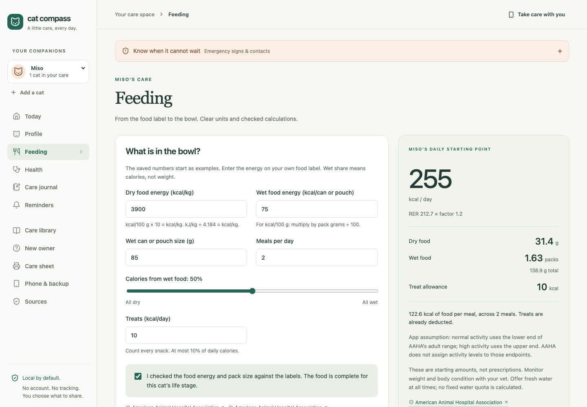
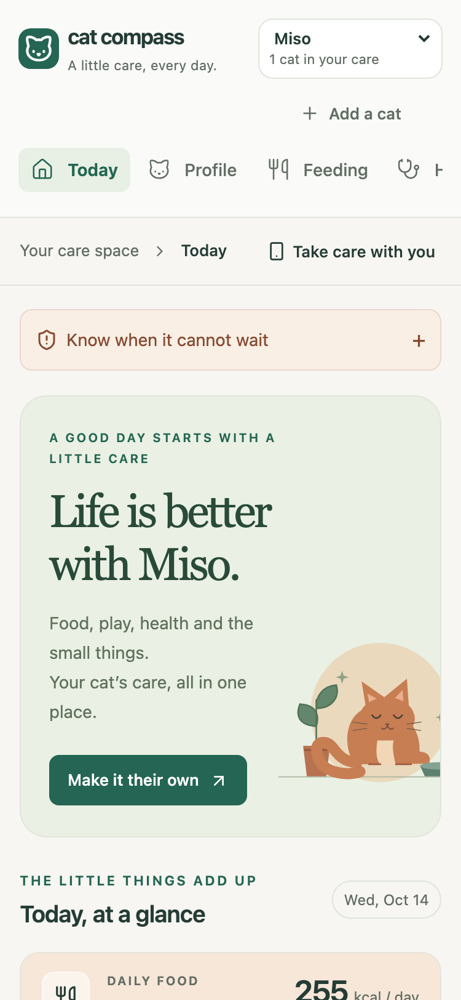

# Cat Compass

A cat care app that keeps food plans, health notes, weights and reminders on your own device, with the source behind each piece of advice.

[](https://github.com/Guinerve/cat-compass/actions/workflows/ci.yml)
[](https://github.com/Guinerve/cat-compass/releases/latest)
[](LICENSE)

<picture>
  <source media="(prefers-color-scheme: dark)" srcset="assets/screenshot-dark.png" />
  
</picture>

[Open the web app](https://guinerve.github.io/cat-compass/) · [Download the desktop app](https://github.com/Guinerve/cat-compass/releases/latest) · [Getting started](docs/getting-started.md) · [Sources and safety](docs/sources-and-safety.md)

I built Cat Compass to keep a cat's daily care in one place without an account. Advice about cats is spread across vet guidelines, clinic pages and food labels. The app turns the label on your cat's food into a daily amount, keeps a weight record and sends reminders to your phone calendar. Each health note links to the page it came from, with the date it was read and what the source does not cover.

There is no account, no analytics and no subscription. Records stay on your device until you export them.

> **Early access. Not veterinary advice.** A veterinarian has not reviewed the app. The desktop builds are unsigned. Follow your vet for treatment, special diets and vaccine dates. [Read the limits](docs/sources-and-safety.md).

## Quick start

Use the [web app](https://guinerve.github.io/cat-compass/) in Chrome, Edge or Safari. After one full load online, you can install it and use it offline.

To run it from source, use Node.js 22 or later:

```bash
git clone https://github.com/Guinerve/cat-compass.git
cd cat-compass
npm ci
npm run dev
```

The dev server listens on `0.0.0.0:5195`. Open `http://localhost:5195` on the same computer.

## What it does

| Page | What you get |
|---|---|
| **Today** | A daily checklist, the food total and the next reminders |
| **Profile** | Age, weight, body condition, vet contacts and microchip number for each cat |
| **Feeding** | Daily grams of dry food and packs of wet food from your labels, with a treat allowance |
| **Health** | Points to discuss with your vet, breed notes and emergency signs |
| **Care journal** | Dated weights, notes, vet visits and a weight chart |
| **Reminders** | Dates you choose, desktop alerts and a calendar file for your phone |
| **Care library** | 15 short guides, each with linked sources and limits |
| **Phone & backup** | A transfer to your phone protected by a password, and full backups |
| **Care sheet** | A printable page for a pet sitter, the fridge or the vet |

## How the feeding plan works



The energy maths follows the AAHA 2021 Nutrition and Weight Management Guidelines, Box 1:

- Resting energy: `RER = 70 × weightKg^0.75`.
- Daily energy: RER times the feline life stage factor. A desexed adult uses 1.2 to 1.4, an intact adult 1.4 to 1.6, an inactive adult 1.0 and a kitten 2.5.
- Treats are at most 10% of daily calories. Their calories come out of the food allowance.
- The app splits the rest between wet and dry food by calories, then converts to grams and packs from the label values.

For example, a 4.4 kg desexed adult with normal activity has an RER of 212.7 kcal. At a factor of 1.2, that is 255 kcal a day. The screenshot shows that plan.

The app gives no amounts until you confirm the profile and the food labels. New profiles start with example values, not facts about your cat. Missing energy values, part meals and unweaned kittens stop the plan. Illness, low body condition, pregnancy and nursing need a daily calorie target from your vet. Weight loss needs a target weight agreed with your vet. The app does not work out a target weight from body condition and does not predict an end date.

The activity mapping is my own assumption, because AAHA does not set one. Normal activity uses the low end of the adult range and high activity uses the high end. The app says so beside the result.

## Phone and backups

- Export reminders as an `.ics` file and import it into a calendar that syncs with your phone. Calendar alerts then work when Cat Compass is closed.
- Move one cat's profile and reminders to the [web app](https://guinerve.github.io/cat-compass/) with a QR code. The link is encrypted with AES-256-GCM and a password of at least 12 characters. It expires after 24 hours.
- Export a full backup to move every record, including notes, weights and checklists.

These are copies. The app does not sync devices, calendar copies do not update, and backup files are not encrypted. [Phone setup and privacy](docs/phone-and-backup.md).

<details>
<summary>See the phone layout</summary>
<p align="center"></p>
</details>

## Sources

The app holds **31 source records**. Each one has the exact page link, the date it was read (13 October 2026), the section checked and its limits. Vet guidelines (AAHA, WSAVA, AAFP and ISFM) support the formula and care principles. University and welfare pages (Cornell, RSPCA) support the warning signs. Clinic pages are labelled as local opinion. Cats.com articles are further reading only.

The app does not diagnose, prescribe medicine, plan milk feeds for newborn kittens or design homemade diets. Most guidance is written for Australia. The breed list is not complete. The ACT rule for a cat born on exactly 1 July 2022 is still unclear, and the app says so.

[Source and safety policy](docs/sources-and-safety.md) · [Research ledger](evidence/veterinary-research.json) · [Evidence notes](evidence/README.md)

## Desktop app

Download installers only from [GitHub Releases](https://github.com/Guinerve/cat-compass/releases/latest). Each release lists SHA-256 checksums.

| Computer | File | Status |
|---|---|---|
| Mac with Apple Silicon | `Cat-Compass-0.2.0-mac-arm64.dmg` | Packaged app checked on a real Mac |
| Intel Mac | `Cat-Compass-0.2.0-mac-x64.dmg` | Built by CI; not yet run on a real machine |
| Windows 64 bit | `Cat-Compass-0.2.0-win-x64.exe` | Built by CI; not yet run on a real machine |
| Linux 64 bit | `Cat-Compass-0.2.0-linux-x64.AppImage` | Built by CI; not yet run on a real machine |

The builds are unsigned and the Mac app is not notarised. Windows may warn about an unknown publisher. Do not turn off system security to install it. Desktop records and browser records are separate until you transfer them. [Install and verify a download](docs/installation.md).

## Testing

Results on 14 October 2026:

- **61 unit tests** cover the feeding limits, storage, backups, transfer, source coverage, calendar export and desktop IPC checks.
- **26 browser tests** run in desktop and phone sized Chromium. They cover saved records, feeding errors, QR transfer, backups, cat removal, printing and an offline reload of the production build.
- The packaged Apple Silicon app passed an offline launch, sandbox, IPC, saved schedule and close to tray check. A copy downloaded from the public release matched its published checksum.
- `npm audit --omit=dev` reports no known issues in runtime packages. The full audit lists 8 moderate advisories in the desktop packaging tools.

```bash
npx playwright install chromium   # once
npm run check                     # unit tests, type check, build and browser tests
npm run test:desktop              # drives the real Electron app with test records
```

Still open: real iOS and Android installs, audible calendar alerts, runtime checks on Intel Mac, Windows and Linux, code signing and a vet review. [Development guide](docs/development.md).

## Help

[Report a bug](https://github.com/Guinerve/cat-compass/issues/new/choose) · [Suggest a change](https://github.com/Guinerve/cat-compass/issues/new/choose) · [Contributing](CONTRIBUTING.md) · [Security](SECURITY.md) · [Changelog](CHANGELOG.md) · [Roadmap](ROADMAP.md)

If your cat is sick or may have eaten something toxic, call a vet. Nobody watches GitHub issues for emergencies. Do not post real vet records or backup files in a public issue.

## Licence

The code is [MIT licensed](LICENSE). Linked sources keep their own rights. The app does not copy articles, photos or code from Cats.com. Cat Compass is not affiliated with Cats.com or with the vet organisations it cites. [Third party notices](THIRD_PARTY_NOTICES.md).
