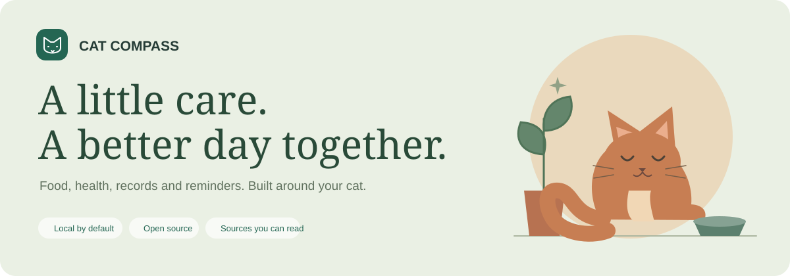

<p align="center">
  
</p>

<p align="center">
  <a href="https://github.com/Guinerve/cat-compass/releases/latest"><strong>Download the desktop app</strong></a> ·
  <a href="https://guinerve.github.io/cat-compass/">Open the web app</a> ·
  <a href="docs/getting-started.md">Getting started</a> ·
  <a href="docs/sources-and-safety.md">Sources & safety</a>
</p>

<p align="center">
  <a href="https://github.com/Guinerve/cat-compass/actions/workflows/ci.yml"></a>
  <a href="https://github.com/Guinerve/cat-compass/releases"></a>
  <a href="LICENSE"></a>
  
</p>

# Cat Compass

A care space for life with your cat. Keep food amounts, health notes, weight records and reminders together. Read the sources behind the guidance. Take a copy to your phone when you need it.

No account. No analytics. No subscription. Records stay on your device unless you choose to export them.

> **Early-access software, not veterinary advice.** The desktop builds are unsigned. A veterinarian has not reviewed or approved the app. Use your vet's instructions for treatment, special diets and vaccine dates. [Read the limits](docs/sources-and-safety.md).


## Download

Download installers from [GitHub Releases](https://github.com/Guinerve/cat-compass/releases/latest), not from an unknown mirror. Each release includes SHA-256 checksums and the source commit.

| Computer | File to choose | Status |
|---|---|---|
| Mac with Apple Silicon | `Cat-Compass-0.2.0-mac-arm64.dmg` | Packaged app checked on a real Mac |
| Intel Mac | `Cat-Compass-0.2.0-mac-x64.dmg` | Automated package build; runtime checks still needed |
| Windows 64-bit | `Cat-Compass-0.2.0-win-x64.exe` | Automated package build; runtime checks still needed |
| Linux 64-bit | `Cat-Compass-0.2.0-linux-x64.AppImage` | Automated package build; runtime checks still needed |

Only download a platform once its file is present on the release page. A build is not the same as a runtime test. The unsigned macOS app is not notarized. Windows may show an unknown-publisher warning. Do not disable system security to install it. [Install and verify a download](docs/installation.md).

Prefer a browser? [Open Cat Compass](https://guinerve.github.io/cat-compass/). Install it from Chrome, Edge or Safari for offline use after one full online load. Browser records and desktop records are separate until you transfer them.

## Care that fits the day

| Tool | What it does |
|---|---|
| **Today** | Daily comfort checks, food summary and upcoming tasks |
| **Profiles** | Separate details, vet contacts and microchip numbers for each cat |
| **Feeding** | Label-based wet/dry amounts, meal portions and a treat allowance |
| **Health** | Vet discussion points, breed notes and emergency signs |
| **Care journal** | Dated weights, observations, vet visits and a weight chart |
| **Reminders** | Dates you choose, desktop alerts and phone calendar export |
| **Care library** | 15 original guides with linked sources and clear limits |
| **Phone & backup** | Password-protected profile transfer and full local backups |
| **Care sheet** | A printable handover for the fridge, a sitter or the vet |

## From the label to the bowl

New profiles start with examples, not assumed facts about your cat. Feeding amounts stay hidden until you confirm the profile and food labels.

- Energy follows **AAHA 2021 feline Box 1**: `RER = 70 × weightKg^0.75`, with the feline life-stage factors.
- Active food needs valid energy units. Missing data and fractional meals do not produce a plan.
- Treats stay within **10% of daily calories**. Their calories come out of the food allowance.
- Illness, low body condition, pregnancy and nursing need a daily calorie target set by your vet.
- Weight loss needs a vet-agreed target. The app does not derive target weight from BCS or predict a finish date.

The normal/high-activity mapping is an app assumption, not an AAHA rule. Calculated portions are starting estimates, not prescriptions. [Feeding setup](docs/getting-started.md#feeding).

## Your phone, without another account

Export `.ics` reminders to a calendar that syncs with your phone. Calendar alerts can work when Cat Compass is closed. Your calendar controls delivery.

Use a password-protected QR link to transfer one cat's profile and reminders to the [HTTPS web app](https://guinerve.github.io/cat-compass/). A full backup also includes notes, weight history and checklists.

Transfers are copies, **not automatic two-way sync**. Calendar edits do not propagate. Backup files are not encrypted. [Phone setup and privacy](docs/phone-and-backup.md).

<details>
<summary>See the phone layout</summary>
<p align="center"></p>
</details>

## Read the evidence

The app includes **31 source records** with exact page links, read dates, checked sections and limits. Veterinary guidelines support the formula and care principles. University and welfare pages support warning signs. Clinic opinions are labelled local and dated. Cats.com is further owner reading, not the calculator authority.

The app does not diagnose disease, prescribe medicine, calculate neonatal milk feeds or formulate homemade diets. Guidance is mainly Australian-facing. The breed list is not complete. The ACT containment boundary for a cat born on 1 July 2022 remains unresolved and is stated as such.

[Source and safety policy](docs/sources-and-safety.md) · [Research ledger](evidence/veterinary-research.json) · [Inspection boundaries](evidence/README.md)

## Build from source

Use Node.js 22 or later.

```bash
git clone https://github.com/Guinerve/cat-compass.git
cd cat-compass
npm ci
npm run dev
```

Development binds to `0.0.0.0:5195`. Production preview uses port `5197`. Both reject port conflicts.

```bash
npm run check          # Unit tests, type check, build and browser tests
npm run desktop        # Build and run Electron
npm run desktop:dist   # Build an installer for the current OS
npm run test:desktop   # Drive the real desktop app with isolated test records
```

Install the test browser once with `npx playwright install chromium`. [Development and release guide](docs/development.md).

## What has been checked

Local results on 13 October 2026:

- **61 unit tests** cover feeding boundaries, storage, transfer, source coverage, calendar export and native IPC validation.
- **24 browser tests** cover desktop and phone-sized Chromium, persistence, feeding errors, QR transfer, backups, printing and production offline reload.
- The packaged **Apple Silicon macOS app** passed offline launch, renderer isolation, restricted preload API, native schedule persistence and close-to-tray checks.
- The production dependency audit reports no known advisories. The full audit still reports eight moderate advisories in development packaging dependencies.

Real iOS/Android installation, audible calendar alerts and non-Apple-Silicon desktop runtime checks remain open. Code signing, notarization and veterinary review are release limits, not completed work. [Testing details](docs/development.md#verification).

## Help and contribute

[Report a bug](https://github.com/Guinerve/cat-compass/issues/new/choose) · [Ask for a feature](https://github.com/Guinerve/cat-compass/issues/new/choose) · [Contribution guide](CONTRIBUTING.md) · [Security policy](SECURITY.md) · [Changelog](CHANGELOG.md) · [Roadmap](ROADMAP.md)

For a sick cat or suspected poisoning, contact a veterinarian. GitHub issues are not monitored as an emergency service. Do not upload real veterinary records or private backup files to public issues.

## Licence

Project code is [MIT licensed](LICENSE). Linked source material retains its own rights. Articles, photographs and application code from Cats.com are not republished in the product. Cat Compass is not affiliated with Cats.com or the veterinary organisations cited. [Third-party notices](THIRD_PARTY_NOTICES.md).
