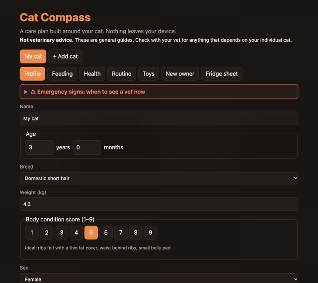
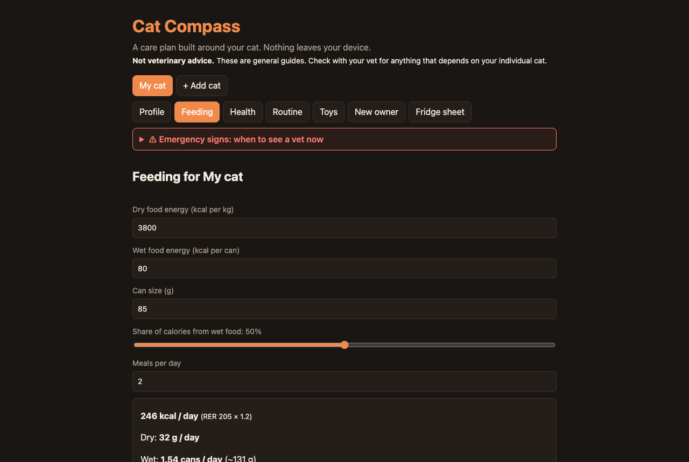

# cat-compass

> A personalised, interactive care plan for your cat.

**Status:** v0.1 core built; energy maths, vaccines and ACT rules checked against sources; UI checked in real Chrome





## The idea

Enter a cat's details and get a complete care plan: how much of *your* food to feed, health risks to watch for, a daily routine, play and toy ideas, and a first-month guide for new owners. Scope v1 at 1–2 days.

## Stack

React, TypeScript, Vite, Vitest. Breed, toy and care content lives in editable JSON. Local storage only, no account.

Dev server binds to `0.0.0.0` on port **5195** so it's reachable over Tailscale (`vite --host 0.0.0.0 --port 5195 --strictPort`). Deploy to GitHub Pages.

## Build plan (v1)

- [ ] (partly done) **Profile wizard:** (single-page form, not a stepped wizard; BCS picker is a 1–9 button row with descriptions, no illustrations yet)  name, age/birthdate, breed (incl. domestic short/long hair), weight with a visual 1–9 body-condition-score picker, sex and desexed status, indoor/outdoor/enclosure, activity level, health conditions, food kcal per kg or per can
- [x] **Feeding:** RER = 70 × kg^0.75 × life-stage factor; grams/cans of the actual food; wet/dry split; meal schedule; water target; weight-loss mode feeds for ideal weight with a safe weekly cap
- [ ] (partly done) **Health:** schedule and breed risks done (11 breeds); the schedule text needs a vet-source check. breed-linked risks and signs to watch; Australian vaccine and parasite schedule (F3 core, FIV for outdoor cats, paralysis ticks on the east coast); checkup rhythm by life stage
- [x] **Red-flag panel:** (8 items, always visible at the top) male cat straining to urinate, not eating >24 h, open-mouth breathing, lily exposure, permethrin dog flea products
- [x] **Daily routine timeline:** 2–3 week tooth-brushing training plan, grooming by coat length, nail trims, litter (one box per cat plus one, scooped daily), play built on hunt → catch → eat → groom → sleep
- [x] **Toys:** (6 entries; more needed) bought and DIY with step-by-step instructions and safety notes (no unsupervised string toys)
- [x] **New owners:** "things I wish I'd had", first-week guide, cat-proofing checklist, shopping list with rough costs
- [x] **ACT mode:** verified against the ACT Government page on 2026-10-13; rules change, so re-check before relying on it. local containment and registration rules (verify current rules before shipping)
- [x] Multiple cats; printable one-page fridge sheet

## Run it

```bash
npm install
npm run dev      # http://0.0.0.0:5195
npm test         # 24 tests
```

## How I know it's right

24 unit tests pass (`src/feeding.test.ts`, `src/health.test.ts`).

Review fixes: invalid weight/age/BCS/meals now show a message instead of `NaN kcal` (including on the printed fridge sheet); corrupt saved data is backed up and reported, not silently replaced; a failed save shows a warning; an error boundary replaces a blank page.

**Verified against sources (2026-10-13):**

- **Energy maths** against the **AAHA 2021 Nutrition and Weight Management Guidelines, Box 1**: RER = 70 × kg^0.75, the worked example (4.5 kg → kg^0.75 = 3.09, RER 216 kcal/day) is a test, and the feline life-stage factors (neutered adult 1.2–1.4, intact 1.4–1.6, inactive/obese-prone 1.0, weight loss 0.8 of **ideal** weight, growth 2.5). Checking found and fixed two errors: I had used 2.0 for kittens aged 4–12 months (AAHA's feline factor is 2.5), and an unsourced +0.2 for high activity and a senior cap. Normal activity now uses the low end of AAHA's range and high activity the high end.
- **ACT rules** from the ACT Government cat pages (microchip, registration over 8 weeks, desexing unless under 3 months, containment for cats born on or after 1 July 2022 and in 17 declared suburbs). This replaced placeholder text that was materially wrong about containment.
- **Vaccines**: core vaccines and the kitten course (from 6–8 weeks, every 2–4 weeks to at least 16 weeks, booster from 26 weeks, then no more often than every 3 years) match the WSAVA 2024 guidelines as summarised in search results; I did not read the PDF itself.

**Also verified (2026-10-13, via search results, not primary papers):** lily toxicity (RSPCA Australia, International Cat Care: all parts including pollen and vase water; kidney failure within days), "not eating for a day: see a vet that day" and the fatty-liver risk (a Sydney vet clinic's triage guidance), and the **0.5–2 % per week** safe weight-loss range (AAHA range as cited by Tufts and a veterinary review; the app uses 1 %). Two claims with no source were **removed**: a "fatal within 24–48 hours" timeframe for urinary blockage, and a 50 ml/kg/day water target.

**Also verified (2026-10-13, via search results, not primary papers):** paralysis-tick signs, including that they are often subtle in cats (RSPCA Queensland, MSD Veterinary Manual, clinic guidance); that some dog tick/flea products contain permethrin which can kill cats (clinic guidance); and breed links for HCM (Maine Coon, Ragdoll, with others reported), PKD (Persian, British Shorthair) and diabetes (Burmese), from consumer genetics and pet-health sites rather than a veterinary reference. **Removed because unsupported or inconsistent:** risk lists for Siamese, Abyssinian and Sphynx, Ragdoll bladder stones, Burmese hypokalaemia, generic domestic-cat risks, and a fixed worming schedule (published schedules disagree, so the app now gives a range and defers to your vet).

**Also verified / corrected (2026-10-13):** sudden hind-leg loss as an emergency (aortic thromboembolism) and paracetamol/ibuprofen toxicity (AVA and an emergency-vet guide, via search). **Removed:** the "about 10 % per BCS point" ideal-weight formula. A study I found shows body fat per BCS point is not uniform (inactive neutered cats averaged 32 % body fat at BCS 5), and I found no source for any weight conversion. Weight-loss mode now needs a **target weight set with your vet** (AAHA says to base the plan on ideal weight) and gives no plan, only an explanation, without one.

**Still unverified:** open-mouth breathing as a red flag (universally treated as an emergency, but I read no source for it) and the "go to a vet now" wording on the other red flags. Everything else in the app is either sourced above or has been removed. All sources came from search results, not primary papers or guideline documents (except AAHA Box 1 and the ACT page, which I read directly).

Sources are named per item in `src/content/*.json` (WSAVA, AAFP / ISFM, RSPCA Australia, Cornell Feline Health Center, AVA) but not yet linked to specific pages.

## Limits

The weight-loss target estimates ideal weight as ~10 % per BCS point above 5. Breed predispositions are tendencies, not diagnoses.

**Not veterinary advice.** "Check with your vet" prompts wherever a recommendation depends on the individual cat.

## Browser check

Checked in real Chrome (headless, driven with puppeteer) on 2026-10-12: the profile form, feeding output and fridge sheet work; a weight of −3 shows "Enter a weight between 0.3 and 15 kg" instead of NaN. Content is partly verified (see below). Not checked: print layout.

## Next (tomorrow)

- Verify the few items listed above as unverified, and replace the consumer-site breed sources with a veterinary reference. Add real URLs per item.
- BCS illustrations; stepped wizard if it feels better.

## Stretch

Weight tracker with trend chart; reminders export to calendar (.ics).

## Definition of done

- [x] Hero GIF or screenshot at the top of this README
- [x] Live demo link or one-command run (`npm install && npm run dev`)
- [ ] "How I know it's right" section filled in with real results
- [ ] Tests passing in CI, badge added
- [ ] "Limits" section written
- [ ] Licence chosen, repo description and topics set
- [ ] Pinned on GitHub profile and added to guinerve.github.io
- [ ] Added to `career-radar/data/cv/portfolio.json`
